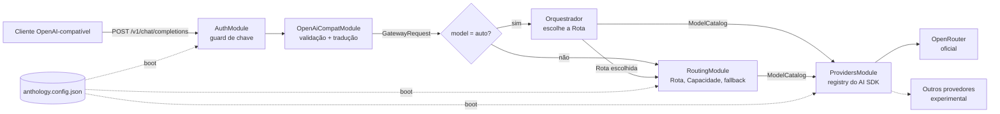

# PRD — Anthology, gateway de LLMs

## 1. Resumo

O Anthology é um gateway HTTP que expõe uma **API compatível com a OpenAI**. Cada chamada vai para
o modelo de linguagem mais apto para aquele trabalho, e **quem decide isso é uma LLM configurada
como orquestradora**. Ela lê a requisição, classifica a tarefa e escolhe uma Rota. A Rota diz qual
modelo atende e para quais cair se ele falhar. O cliente também pode pedir uma Rota diretamente,
sem passar pelo orquestrador.

A configuração fica em um arquivo JSON. O backend é NestJS com o Vercel AI SDK. O OpenRouter é o
provedor oficial inicial, numa arquitetura que aceita outros provedores sem reescrita.

## 2. Problema

- Cada aplicação escolhe e fixa o modelo no próprio código. **Trocar o modelo de uma tarefa exige
  deploy em cada aplicação.**
- Quem chama nem sempre sabe qual modelo é o melhor para cada pedido, e um modelo só para tudo
  paga caro no simples ou entrega pouco no difícil.
- Não há um lugar único para curar "qual modelo é bom para quê", nem para fazer fallback quando um
  modelo cai ou limita requisições.
- Chaves de provedor ficam espalhadas pelas aplicações.

## 3. Objetivos e não-objetivos

**Objetivos (v1)**

- O-1. Qualquer cliente OpenAI-compatível usa o gateway trocando só `baseURL`, chave e
  `model: "auto"`.
- O-2. Com `auto`, a LLM orquestradora escolhe a Rota adequada a cada requisição, sem o cliente
  precisar classificar a própria tarefa.
- O-3. O que cada Rota atende, e com qual modelo, é uma edição revisável num arquivo JSON, sem
  tocar em cliente.
- O-4. Falha de um modelo, ou do próprio orquestrador, é absorvida sem o cliente perceber, sempre
  que nada foi enviado a ele ainda.
- O-5. Plugar um provedor novo não altera API, tradução nem roteamento.

**Não-objetivos (v1)**

- O orquestrador decompor a tarefa em várias chamadas a modelos diferentes (multiagente). Ele
  escolhe **uma** Rota por requisição ([SPEC-009](specs/SPEC-009-orquestrador.md)).
- Execução de tools no servidor e MCP ([ADR-0007](adrs/0007-tool-calling-transparente.md)).
- Rate limit, orçamento por chave, painel administrativo, persistência ([ADR-0009](adrs/0009-gateway-stateless-sem-banco-na-v1.md)).
- Embeddings, áudio, imagem, Responses API ([ADR-0001](adrs/0001-api-publica-compativel-com-openai.md)).

## 4. Premissas

Estas premissas sustentam o desenho. Se alguma estiver errada, as specs citadas mudam.

| # | premissa | afeta |
|---|---|---|
| P-1 | Classificar a tarefa entre Rotas descritas em texto é uma decisão que uma LLM pequena e rápida toma bem | ADR-0006, SPEC-009 |
| P-2 | Uma chamada extra de LLM antes de cada requisição `auto` é custo e latência aceitáveis | ADR-0006, RNF-07 |
| P-3 | Os consumidores são aplicações internas, com chave emitida pelo time | SPEC-007 |
| P-4 | O volume da v1 cabe no limite de crédito da conta do OpenRouter como teto de gasto | ADR-0009 |
| P-5 | Os clientes executam as próprias tools | ADR-0007 |
| P-6 | Reiniciar o serviço para mudar configuração é aceitável na v1 | ADR-0005 |

## 5. Glossário

| termo | definição | evitar |
|---|---|---|
| **Orquestrador** | A LLM configurada para escolher a Rota de cada requisição `auto` | roteador, classificador |
| **Rota** | Tipo de tarefa nomeado (ex.: `code`), com uma descrição de quando usá-la, que aponta para um Modelo-alvo e fallbacks | alias, perfil |
| **`auto`** | Valor de `model` que entrega a escolha da Rota ao Orquestrador; id reservado | — |
| **Continuação** | Requisição que segue um laço de tool calling e reaproveita a Rota anterior, informada pelo cliente | sessão |
| **Modelo** | Entrada de `models` na configuração: um modelo de um provedor, com Capacidades e padrões | — |
| **Modelo-alvo** | O Modelo primário de uma Rota (`target`) | — |
| **Modelo upstream** | O id do modelo no provedor (`modelId`, ex.: `anthropic/claude-sonnet-4.5`) | — |
| **Provedor** | Serviço que executa modelos (OpenRouter) e a fábrica que o integra | — |
| **Candidato** | Cada Modelo da cadeia `[target, ...fallbacks]` de uma Rota | — |
| **Capacidade** | Recurso declarado de um Modelo: `tools`, `vision`, `json_schema` | feature |
| **Rota elegível** | Rota permitida para a chave e com pelo menos um Candidato capaz de atender a requisição | — |
| **Ponto de commit** | O instante em que o primeiro byte vai ao cliente; depois dele não há fallback | — |
| **Chave do gateway** | Credencial do cliente para o Anthology; diferente da chave do provedor | token |

## 6. Requisitos funcionais

| id | requisito | spec | ADR |
|---|---|---|---|
| RF-01 | Expor `POST /v1/chat/completions` compatível com a OpenAI, sem streaming | [SPEC-001](specs/SPEC-001-api-openai-compativel.md) | [0001](adrs/0001-api-publica-compativel-com-openai.md) |
| RF-02 | Streaming SSE no formato `chat.completion.chunk`, com `[DONE]` e `include_usage` | [SPEC-006](specs/SPEC-006-streaming-sse.md) | [0001](adrs/0001-api-publica-compativel-com-openai.md), [0002](adrs/0002-backend-em-nestjs.md) |
| RF-03 | `GET /v1/models` lista `auto` e as Rotas visíveis à chave | [SPEC-001](specs/SPEC-001-api-openai-compativel.md) | [0006](adrs/0006-roteamento-por-orquestrador.md) |
| RF-04 | Resolver a Rota (pedida ou escolhida) para a cadeia de Candidatos, filtrando por Capacidade | [SPEC-003](specs/SPEC-003-roteamento-e-fallback.md) | [0006](adrs/0006-roteamento-por-orquestrador.md) |
| RF-05 | Fallback ordenado entre Candidatos em erro retentável, antes do Ponto de commit | [SPEC-003](specs/SPEC-003-roteamento-e-fallback.md) | [0008](adrs/0008-fallback-no-gateway.md) |
| RF-06 | Tool calling transparente: `tools` → `tool_calls`, com o laço no cliente | [SPEC-005](specs/SPEC-005-traducao-de-mensagens-e-tool-calling.md) | [0007](adrs/0007-tool-calling-transparente.md) |
| RF-07 | Entrada de imagem (`image_url`, URL ou data URL) | [SPEC-005](specs/SPEC-005-traducao-de-mensagens-e-tool-calling.md) | [0003](adrs/0003-vercel-ai-sdk-como-camada-de-llm.md) |
| RF-08 | Saída estruturada (`response_format`: `json_object`, `json_schema`) | [SPEC-005](specs/SPEC-005-traducao-de-mensagens-e-tool-calling.md) | [0003](adrs/0003-vercel-ai-sdk-como-camada-de-llm.md) |
| RF-09 | Configuração declarativa em JSON, validada no boot, com segredos só por nome de variável | [SPEC-002](specs/SPEC-002-arquivo-de-configuracao.md) | [0005](adrs/0005-configuracao-declarativa-em-json.md) |
| RF-10 | OpenRouter como provedor oficial, com smoke test real no CI | [SPEC-004](specs/SPEC-004-camada-de-provedores.md) | [0004](adrs/0004-openrouter-como-provedor-oficial-inicial.md) |
| RF-11 | Provedor novo entra por fábrica, sem tocar API, tradução ou roteamento | [SPEC-004](specs/SPEC-004-camada-de-provedores.md) | [0003](adrs/0003-vercel-ai-sdk-como-camada-de-llm.md) |
| RF-12 | Autenticação por chave do gateway, com escopo por Rota | [SPEC-007](specs/SPEC-007-autenticacao.md) | [0005](adrs/0005-configuracao-declarativa-em-json.md), [0009](adrs/0009-gateway-stateless-sem-banco-na-v1.md) |
| RF-13 | Com `model: "auto"`, a LLM orquestradora escolhe a Rota entre as elegíveis, com continuação em laço de tools e `defaultRoute` em caso de falha | [SPEC-009](specs/SPEC-009-orquestrador.md), [SPEC-002](specs/SPEC-002-arquivo-de-configuracao.md) | [0006](adrs/0006-roteamento-por-orquestrador.md) |

## 7. Requisitos não funcionais

| id | requisito | spec | ADR |
|---|---|---|---|
| RNF-01 | Overhead do gateway até o primeiro byte, sem contar orquestração, com meta de p95 ≤ 50 ms (a validar no M2) | [SPEC-008](specs/SPEC-008-observabilidade.md) | — |
| RNF-02 | Stateless: qualquer réplica atende qualquer requisição | [SPEC-008](specs/SPEC-008-observabilidade.md) | [0009](adrs/0009-gateway-stateless-sem-banco-na-v1.md) |
| RNF-03 | Nenhum segredo em arquivo, log ou resposta; conteúdo de conversa fora do log por padrão | [SPEC-002](specs/SPEC-002-arquivo-de-configuracao.md), [SPEC-007](specs/SPEC-007-autenticacao.md), [SPEC-008](specs/SPEC-008-observabilidade.md) | [0005](adrs/0005-configuracao-declarativa-em-json.md) |
| RNF-04 | Toda requisição gera um evento de log com Rota, quem a escolheu, tentativas, modelo, tokens e latência | [SPEC-008](specs/SPEC-008-observabilidade.md) | [0008](adrs/0008-fallback-no-gateway.md) |
| RNF-05 | Compatibilidade provada por teste de contrato com os SDKs oficiais `openai` (Node e Python) | [SPEC-001](specs/SPEC-001-api-openai-compativel.md) | [0001](adrs/0001-api-publica-compativel-com-openai.md) |
| RNF-06 | Configuração inválida impede o boot (fail-fast), com todos os erros e seus caminhos | [SPEC-002](specs/SPEC-002-arquivo-de-configuracao.md) | [0005](adrs/0005-configuracao-declarativa-em-json.md) |
| RNF-07 | Orquestração com meta de p95 ≤ 1 s e teto duro no timeout configurado (a validar no M5) | [SPEC-008](specs/SPEC-008-observabilidade.md), [SPEC-009](specs/SPEC-009-orquestrador.md) | [0006](adrs/0006-roteamento-por-orquestrador.md) |

## 8. Arquitetura em uma página



A dependência é de mão única: `OpenAiCompat → Routing (com o Orquestrador dentro) → Providers`. O
orquestrador chama a LLM pelo mesmo `ModelCatalog` que as Rotas usam. Só a camada de tradução
conhece o formato OpenAI, e só a pasta de cada provedor conhece o pacote dele.

## 9. Índice de decisões (ADRs)

| ADR | decisão | status |
|---|---|---|
| [0001](adrs/0001-api-publica-compativel-com-openai.md) | Contrato público é um subconjunto da Chat Completions da OpenAI | aceito |
| [0002](adrs/0002-backend-em-nestjs.md) | Backend em NestJS, com módulos de mão única | aceito |
| [0003](adrs/0003-vercel-ai-sdk-como-camada-de-llm.md) | Vercel AI SDK como camada única de LLM (em vez de proxy direto) | aceito |
| [0004](adrs/0004-openrouter-como-provedor-oficial-inicial.md) | OpenRouter como único provedor oficial da v1 | aceito |
| [0005](adrs/0005-configuracao-declarativa-em-json.md) | Configuração em JSON, validada no boot, segredo só por nome de env | aceito |
| [0006](adrs/0006-roteamento-por-orquestrador.md) | Uma LLM orquestradora escolhe a Rota (`auto`); Rota explícita continua possível; reclassifica a cada requisição | aceito |
| [0007](adrs/0007-tool-calling-transparente.md) | O gateway não executa tools; um passo só | aceito |
| [0008](adrs/0008-fallback-no-gateway.md) | Fallback pelo gateway, só antes do Ponto de commit | aceito |
| [0009](adrs/0009-gateway-stateless-sem-banco-na-v1.md) | Sem banco na v1; sem rate limit nem orçamento no gateway | aceito |

Todos os ADRs foram aceitos em 2026-10-22. Uma decisão nova entra como `proposto` e só passa a
`aceito` com aprovação do time.

## 10. Índice de specs

| spec | escopo | requisitos |
|---|---|---|
| [SPEC-001](specs/SPEC-001-api-openai-compativel.md) | Endpoints, parâmetros, resposta, headers e erros | RF-01, RF-03, RNF-05 |
| [SPEC-002](specs/SPEC-002-arquivo-de-configuracao.md) | Formato, validação e carga do JSON (inclui o bloco `orchestrator`) | RF-09, RF-13, RNF-03, RNF-06 |
| [SPEC-003](specs/SPEC-003-roteamento-e-fallback.md) | Rota → candidatos, Capacidade, merge de parâmetros, fallback | RF-04, RF-05 |
| [SPEC-004](specs/SPEC-004-camada-de-provedores.md) | Fábricas, registry, OpenRouter, níveis de suporte | RF-10, RF-11 |
| [SPEC-005](specs/SPEC-005-traducao-de-mensagens-e-tool-calling.md) | Tradução OpenAI ↔ AI SDK, tools, imagem, saída estruturada | RF-06, RF-07, RF-08 |
| [SPEC-006](specs/SPEC-006-streaming-sse.md) | SSE, tool calls incrementais, erro em stream, abort | RF-02 |
| [SPEC-007](specs/SPEC-007-autenticacao.md) | Chave do gateway, escopo por Rota, regras de segredo | RF-12, RNF-03 |
| [SPEC-008](specs/SPEC-008-observabilidade.md) | Logs, health, desligamento, metas de latência | RNF-01 a RNF-04, RNF-07 |
| [SPEC-009](specs/SPEC-009-orquestrador.md) | Orquestrador: Rotas elegíveis, prompt, recorte da conversa, saída, continuação, falha | RF-13, RNF-07 |

## 11. Marcos

Cada marco termina com os critérios de aceite das specs citadas passando no CI.

| marco | entrega | specs |
|---|---|---|
| M0 | Esqueleto NestJS, carga e validação da config, `/health` e `/ready`, logs | SPEC-002, SPEC-008 (parcial) |
| M1 | Chat sem stream, ponta a ponta via OpenRouter com Rota explícita: auth, roteamento sem fallback, tradução de texto | SPEC-001, SPEC-003 (1–2), SPEC-004, SPEC-005 (texto), SPEC-007 |
| M2 | Streaming SSE e medição do overhead (RNF-01) | SPEC-006, SPEC-008 |
| M3 | Tool calling, imagem e saída estruturada | SPEC-005 completa |
| M4 | Filtro por Capacidade e fallback, com e sem stream | SPEC-003 completa |
| M5 | Orquestrador (`auto`), continuação, `defaultRoute` e medição de RNF-07 | SPEC-009, SPEC-001 (critério 6) |
| M6 | Endurecimento: desligamento gracioso, testes de contrato em Python, smoke real no CI | SPEC-001 (critério 2), SPEC-004 (critério 5), SPEC-008 |

O orquestrador vem depois do M3 porque depende da saída estruturada, e depois do M4 porque a Rota
que ele escolhe precisa já fazer fallback.

## 12. Métricas de sucesso

- Dois consumidores reais migrados para o gateway com `model: "auto"`, cada um trocando só
  `baseURL`, chave e nome do modelo.
- Uma troca de modelo de Rota feita em produção só por PR na configuração, sem deploy de cliente.
- Taxa de requisições `auto` que caíram na `defaultRoute` por falha do orquestrador, visível no log
  (`routedBy: default`). É o termômetro da saúde do orquestrador.
- Taxa de requisições salvas por fallback (`attempts > 1` com `outcome: ok`).

## 13. Riscos

| risco | efeito | mitigação |
|---|---|---|
| Orquestrador escolhe mal | tarefa difícil cai em modelo fraco, ou simples em modelo caro | `description` das Rotas revisada em PR; `reason` disponível com `includeContent` para depurar; o cliente pode fixar a Rota |
| Prompt injection no roteamento | o usuário induz a escolha de uma Rota cara | o `enum` limita às Rotas que a chave já pode usar ([ADR-0006](adrs/0006-roteamento-por-orquestrador.md)) |
| Latência do orquestrador | TTFT maior em toda requisição `auto` | modelo rápido, timeout curto e `defaultRoute`; meta RNF-07 |
| Troca de modelo no meio de uma conversa | respostas de qualidade desigual entre turnos | continuação por header em laço de tools; o cliente pode fixar a Rota |
| OpenRouter fora do ar | todas as Rotas e o orquestrador param | aceito na v1 ([ADR-0004](adrs/0004-openrouter-como-provedor-oficial-inicial.md)); o segundo provedor oficial resolve |
| Breaking change do AI SDK entre majors | tradução e stream quebram no upgrade | versão pinada; testes de contrato como rede ([ADR-0003](adrs/0003-vercel-ai-sdk-como-camada-de-llm.md)) |
| Dupla tradução perde campo que algum cliente usa | comportamento diferente do esperado | parâmetro não honrado é rejeitado com 400, nunca ignorado em silêncio (SPEC-001) |
| Gasto sem controle no gateway | conta alta | limite de crédito no OpenRouter; consumo no log por `keyId` ([ADR-0009](adrs/0009-gateway-stateless-sem-banco-na-v1.md)) |
| Proxy corporativo derruba stream ocioso | streams de modelos de raciocínio cortados | `: keep-alive` a cada 15 s depois do commit (SPEC-006) |

## 14. Questões em aberto

| # | questão | bloqueia |
|---|---|---|
| Q-01 | Expor o reasoning dos modelos (ex.: `reasoning_content` no delta)? A v1 descarta. | — |
| Q-02 | Suportar `/v1/responses` numa v2? | — |
| Q-03 | Suportar `/v1/embeddings`? | — |
| Q-04 | Qual modelo será o orquestrador, e como medir se ele escolhe bem (conjunto de avaliação com requisições rotuladas)? | M5 |
| Q-05 | Hot reload da configuração? | — |
| Q-06 | Quando entra persistência para rate limit e orçamento? | — |
| Q-07 | Qual API exata de saída estruturada do AI SDK atende `json_object`, `json_schema` e a saída do orquestrador na versão pinada? | M3, M5 |

## 15. Estrutura de documentos

```text
docs/
├── PRD.md        ← este documento: o quê e por quê, com o índice de tudo
├── adrs/         ← decisões difíceis de reverter, uma por arquivo, numeradas
└── specs/        ← como cada parte se comporta, com critérios de aceite verificáveis
```

Decisão nova vira ADR com o próximo número. ADR revertido não é apagado: ganha
`status: substituído por ADR-NNNN`. Spec que muda de comportamento atualiza o próprio critério de
aceite no mesmo PR do código.
